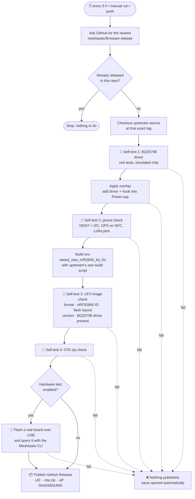

# Meshtastic for XIAO nRF52840 + Wio-SX1262: I2C edition

[](https://github.com/aljaz77/Meshtastic-XIAO-nRF52840-Wio-SX1262-Kit-I2C-firmware-2.8.0.2/actions/workflows/build.yml)
[](https://github.com/aljaz77/Meshtastic-XIAO-nRF52840-Wio-SX1262-Kit-I2C-firmware-2.8.0.2/releases)

Ready-to-flash [Meshtastic](https://meshtastic.org) firmware for the
**Seeed Studio XIAO nRF52840 + Wio-SX1262 kit** (SKU 102010710, or the
standalone Wio-SX1262 for XIAO, SKU 113010003). This build **uses pins D6/D7 as
an I2C bus** (for sensors, OLED screens and so on) instead of the GPS serial
port, and includes a driver for a **BQ25798 solar/MPPT charger** add-on board.

A GitHub Action **checks for new Meshtastic releases every 6 hours**. For each
new release it rebuilds this firmware, self-tests it and publishes it on the
[Releases page](../../releases).

---

## Contents

- [Why this firmware?](#why-this-firmware)
- [Pinout](#pinout)
- [Wiring an I2C device](#wiring-an-i2c-device)
- [Solar charger add-on (BQ25798)](#solar-charger-add-on-bq25798)
- [Flashing](#flashing)
- [How the automatic build works](#how-the-automatic-build-works)
- [Self-tests](#self-tests)
- [Running and configuring the workflow](#running-and-configuring-the-workflow)
- [Optional: test on real hardware](#optional-test-on-real-hardware)
- [Building it yourself](#building-it-yourself)
- [Credits and license](#credits-and-license)

---

## Why this firmware?

The standard Meshtastic firmware for the XIAO nRF52840 kit
(`seeed_xiao_nrf52840_kit`) reserves the only easy-to-reach spare pins, **D6 and
D7**, for the GPS module's UART. I2C goes to the tiny NFC pads on the back of
the board, where it is hard to solder.

Meshtastic also has an **I2C variant** (`seeed_xiao_nrf52840_kit_i2c`) that
swaps them:

|                  | Standard firmware   | **This firmware (I2C)**  |
| ---------------- | ------------------- | ------------------------ |
| D6 / D7          | GPS UART            | **I2C SDA / SCL**        |
| NFC1 / NFC2 pads | I2C SDA / SCL       | GPS UART                 |
| D0               | GPS standby         | **User button**          |

Official Meshtastic releases don't ship a ready-made binary for this variant
(upstream marks it `board_level = extra`), so this repo builds it for you. It
uses upstream source plus one small addition: the
[BQ25798 solar charger driver](#solar-charger-add-on-bq25798), kept in
[`overlay/`](overlay/).

> [!IMPORTANT]
> If you use the **Seeed L76K GNSS module** that plugs onto the kit, it expects
> GPS on D6/D7 and will **not** work with this firmware unless you re-wire it
> to the NFC pads. Use this firmware when you want I2C more than the plug-in
> GPS.

---

## Pinout

| Function            | XIAO pin      | nRF52840 GPIO | Notes                               |
| ------------------- | ------------- | ------------- | ----------------------------------- |
| **I2C SDA**         | **D6**        | P1.11         | your sensors / display              |
| **I2C SCL**         | **D7**        | P1.12         |                                     |
| GPS TX (MCU → GPS)  | NFC1 pad      | P0.09         | pads on the underside of the XIAO   |
| GPS RX (GPS → MCU)  | NFC2 pad      | P0.10         |                                     |
| User button         | D0            | P0.02         | to GND, conflicts with L76K standby |
| LoRa NSS / CS       | D4            | P0.04         | used by the Wio-SX1262              |
| LoRa DIO1           | D1            | P0.03         | used by the Wio-SX1262              |
| LoRa BUSY           | D3            | P0.29         | used by the Wio-SX1262              |
| LoRa RESET          | D2            | P0.28         | used by the Wio-SX1262              |
| LoRa RXEN           | D5            | P0.05         | used by the Wio-SX1262              |
| SPI SCK / MISO / MOSI | D8 / D9 / D10 | P1.13 / P1.14 / P1.15 | used by the Wio-SX1262 |

These values come straight from upstream
[`variant.h`](https://github.com/meshtastic/firmware/blob/master/variants/nrf52840/seeed_xiao_nrf52840_kit/variant.h).
Every automated build re-checks them (see [Self-tests](#self-tests)), so if
Meshtastic ever moves a pin, the build fails instead of publishing firmware
that doesn't match your wiring.

---

## Wiring an I2C device

```
 I2C device             XIAO nRF52840
 ----------             -------------
   VCC  ──────────────  3V3
   GND  ──────────────  GND
   SDA  ──────────────  D6
   SCL  ──────────────  D7
```

- Most breakout boards (BME280, BME680, SHT31, INA219, SSD1306 OLED and so on)
  already have pull-up resistors. With a bare chip, add **4.7 kΩ pull-ups** from
  SDA and SCL to 3V3.
- Power I2C devices from **3V3**, not 5V.
- Meshtastic detects supported sensors and screens on boot. The serial log
  shows `I2C devices found` with their addresses. Enable *Environment
  metrics* in the Telemetry module settings to see sensor readings.

## Solar charger add-on (BQ25798)

This firmware includes a driver for the **TI BQ25798**, a buck-boost
battery charger with built-in **MPPT** (maximum power point tracking) for solar
panels. It's for a carrier PCB that holds the XIAO kit and adds solar charging,
talking to the XIAO over the D6/D7 I2C bus.

The charger is **detected automatically** at boot. Without it, the node behaves
exactly like stock Meshtastic, so the same firmware works with or without your
PCB.

### What the firmware does with it

| Feature | Details |
| ------- | ------- |
| **Battery reporting** | Battery voltage, %, *charging* and *external power* in the Meshtastic app come from the BQ25798's 1 mV ADC instead of the XIAO's resistor divider. "External power" means the panel is delivering usable power (the chip's *power good*), not just any voltage. |
| **MPPT on** | The chip tracks the panel's best operating point, so you get the most charge out of a weak or partly shaded panel. |
| **Safe defaults** | Charge voltage, charge current and input limits stay at what your **PROG resistor** sets in hardware, unless you override them (see below). The firmware refuses any charge voltage above 4.4 V per cell. |
| **Self-healing config** | The chip's I2C watchdog is turned off so settings don't revert while the MCU sleeps. If the chip does reset (brown-out, battery swap), the firmware notices and re-applies the settings. |
| **Low-power measurements** | The ADC runs one conversion per reading (every 5 s) instead of continuously, and polling never blocks. |
| **Power telemetry** | Solar panel, battery and system voltage/current are sent as Meshtastic **power metrics**, so you can watch them in the app and graph them over time. See [Power telemetry](#power-telemetry) below. |
| **Status log** | Once a minute the serial log shows a line such as:<br>`BQ25798: bat 3912mV 250mA \| in 18230mV 90mA \| sys 3922mV \| Fast charge (CC) \| die 31C`<br>plus warnings for battery-temperature limits and faults. |
| **Restarts with the sun** | On nRF52, Meshtastic's low-battery shutdown is permanent until someone presses reset, so a solar node that drains overnight would stay dead. Instead, on a low-battery shutdown the firmware puts the BQ25798 into **ship mode**, which cuts power to the whole board after 10 s. The chip leaves ship mode when the panel delivers power again (or QON is pressed), and the XIAO boots normally. Turning the node off from the app does *not* do this. |

> [!NOTE]
> During boot, the I2C scanner prints `BQ25896` for address `0x6B`. That's
> upstream's scanner mistaking the BQ25798 for a related chip. It's harmless;
> look for `BQ25798 solar charger found` a few lines later.

### Power telemetry

The charger's readings go out as standard Meshtastic **power metrics**. These
show up under the node's telemetry in the Meshtastic apps, and on other nodes
in the mesh that receive them. No extra sensor is needed.

| Channel | Reading | Voltage | Current |
| ------- | ------- | ------- | ------- |
| **Ch1** | Solar panel input | panel voltage | mA drawn from the panel |
| **Ch2** | Battery | battery voltage | mA, **positive = charging**, negative = discharging |
| **Ch3** | System rail (feeds the XIAO) | SYS voltage | *(not measured)* |

Power telemetry is **off by default** in Meshtastic. Turn on power
measurement in the app's Telemetry module settings (and the power screen too
if you have a display), or with the CLI:

```bash
meshtastic --set telemetry.power_measurement_enabled true --set telemetry.power_update_interval 1800
```

`power_update_interval` is in seconds: 1800 sends one reading every 30
minutes. Every packet costs airtime on the shared mesh, so don't set it very
short on a busy network. The app still gets fresh values more often while
it's connected.

If you also fit an INA219/INA226/INA3221 power sensor, its channels are left
untouched and the charger's readings move to the next free channels. The boot
log shows the mapping, e.g. `BQ25798 power telemetry: solar input=ch1,
battery=ch2, system=ch3`.

### Settings

All settings are optional build flags. `0` means "keep the hardware default".

| Flag | Default | Meaning |
| ---- | ------- | ------- |
| `BQ25798_CHARGE_VOLTAGE_MV` | 0 (PROG) | Full-charge voltage, e.g. `4200` Li-ion, `4100` for longer cell life, `3600` LiFePO4 |
| `BQ25798_CHARGE_CURRENT_MA` | 0 (PROG) | Max battery charge current |
| `BQ25798_INPUT_CURRENT_MA` | 0 | Max current drawn from the panel (the lower of this and the ILIM_HIZ resistor applies) |
| `BQ25798_MIN_SYS_MV` | 0 | Minimum system (SYS) voltage |
| `BQ25798_ENABLE_MPPT` | 1 | Solar MPPT on/off |
| `BQ25798_INPUT_VOLTAGE_MV` | 0 | Fixed input voltage limit, only when MPPT is off |
| `BQ25798_IGNORE_TS` | 0 | Set to 1 only if there is **no** thermistor (see the PCB checklist) |
| `BQ25798_SHIP_MODE_ON_LOW_BATTERY` | 1 | The "restart with the sun" behaviour above |
| `BQ25798_POLL_INTERVAL_MS` / `BQ25798_LOG_INTERVAL_MS` | 5000 / 60000 | Read and log intervals |
| `HAS_BQ25798` | 1 | Set to 0 to leave the driver out |

For the **automatic releases**, set them in the repository variable
`EXTRA_BUILD_FLAGS`, e.g. `-DBQ25798_CHARGE_VOLTAGE_MV=3600 -DBQ25798_CHARGE_CURRENT_MA=500`.
For a local build, export the same string as `PLATFORMIO_BUILD_FLAGS`.

> [!WARNING]
> **LiFePO4 users:** also add
> `-DOCV_ARRAY=3650,3400,3340,3320,3300,3280,3270,3260,3240,3200,2500` (Meshtastic's
> LiFePO4 curve) so the battery % and low-battery cutoff are right. And never plug the XIAO's own USB port in while the pack
> is connected: the XIAO's onboard charger would push the pack towards 4.2 V
> (see the PCB checklist).

### PCB design checklist

```
 Solar panel ──► VBUS / VAC1 ┌──────────┐ SYS ──────► XIAO BAT+ pad
                             │ BQ25798  │ BAT ◄─────► 1S cell (+ 10 kΩ NTC on TS)
 XIAO D6 (SDA) ◄────────────►│  @ 0x6B  │
 XIAO D7 (SCL) ◄────────────►│          │ GND ──────► XIAO BAT− / GND
                             └──────────┘
```

1. **1S battery only** (one Li-ion/LiPo or LiFePO4 cell). SYS follows the
   battery voltage and feeds the XIAO's BAT+ pad directly. A 2S–4S pack would
   destroy the XIAO unless you add a buck converter.
2. **PROG resistor**: selects 1-cell mode and the default charge settings at
   power-up (see the datasheet's PROG table). The firmware reads the cell count
   back and logs it.
3. **TS thermistor**: put a 10 kΩ NTC on the cell, with the bias network from
   REGN per the datasheet. Without a valid TS voltage the chip won't charge.
   Lithium cells must not be charged below 0 °C, which matters on an outdoor
   solar node. `BQ25798_IGNORE_TS=1` exists, but it removes that protection.
4. **ILIM_HIZ**: fit the resistor that sets the hardware input-current limit.
5. **/CE** to GND through a resistor, so charging is enabled. **QON**: an
   optional button; it also wakes the board from ship mode. **INT / STAT**:
   optional. The XIAO has no free GPIO in this variant, so the firmware polls
   over I2C.
6. **I2C pull-ups**: 4.7 kΩ from SDA and SCL to the XIAO's 3V3. Address 0x6B
   is fixed, so don't put another 0x6B device on the bus (QMI8658 IMU,
   BQ25896, Sensirion SEN6x).
7. **Panel**: must stay within the chip's input range (3.6–24 V; check the
   datasheet for absolute maximums). A panel whose maximum-power voltage is
   well above the battery voltage, e.g. a 6 V or 12 V panel, works best with
   MPPT.
8. **XIAO USB port**: the XIAO's own charger (BQ25101) charges whatever is on
   BAT+ when USB is plugged in. With a Li-ion cell that's harmless (both stop
   at 4.2 V), but with LiFePO4, keep USB unplugged while the pack is connected
   or block that path on your PCB.

### Bring-up test when your PCB arrives

1. Flash, open the serial log (e.g. `meshtastic --noproto`, which acts as a
   plain serial terminal) and look for
   `BQ25798 solar charger found at 0x6b (part info 0x19, 1-cell)`.
2. Compare `bat …mV` in the status line with a multimeter on the cell. They
   should agree closely.
3. Cover the panel and the state should change to `Not charging` with input
   near 0 mV. Uncover it and you should see `Fast charge` and a positive
   battery current.
4. Enable power telemetry (see above) and check the app: Ch1 should match the
   panel, and Ch2 should match the battery, with a positive current while
   charging.
5. **Ship mode:** run the node from a bench supply instead of the cell, with
   the panel disconnected. Lower the voltage below about 3.1 V. After about
   10 low readings, the log shows `entering ship mode`, and about 10 s later
   SYS turns off. Connect the panel and the node should boot again.

> [!NOTE]
> The driver is unit-tested against a simulated chip and compiled on every
> build, but it hasn't run on a real BQ25798 yet. Steps 1–5 above are the
> first hardware check.

---

## Flashing

### Option A: drag and drop (UF2)

1. Download `firmware-seeed_xiao_nrf52840_kit_i2c-<version>.uf2` from the
   [latest release](../../releases).
2. Plug the XIAO into USB and **double-tap the reset button**. A USB drive
   appears.
3. Copy the `.uf2` file onto that drive. The board reboots into Meshtastic on
   its own. The drive disappearing, sometimes with an "eject" warning, is normal.

> [!TIP]
> **Moving from another firmware, or the device acting oddly?** Copy
> `Meshtastic_nRF52_factory_erase_v3_S140_7.3.0.uf2` (also on the Releases page)
> first. It wipes all stored settings. Then double-tap reset again and copy
> the firmware `.uf2`.

### Option B: over Bluetooth (OTA)

Use `firmware-…-ota.zip` with Nordic's **nRF Device Firmware Update** app
(Android or iOS). See Meshtastic's
[nRF52 OTA guide](https://meshtastic.org/docs/getting-started/flashing-firmware/nrf52/ota/).

> The file `firmware-seeed_xiao_nrf52840_kit_i2c-2.8.0.2a20ee5.uf2` in this
> repository is the original hand-built 2.8.0.2 image. Newer versions are on
> the [Releases page](../../releases).

---

## How the automatic build works

The workflow lives in [`.github/workflows/build.yml`](.github/workflows/build.yml).



Key points:

- **Upstream is the source of truth.** The workflow doesn't keep a fork of
  Meshtastic. It checks out the exact upstream release tag, adds the
  [overlay](overlay/), and builds with Meshtastic's own `bin/build-nrf52.sh`
  and the PlatformIO version upstream pins.
- **A tiny, robust patch.** [`scripts/apply_overlay.py`](scripts/apply_overlay.py)
  copies three new header files in and adds 4 lines to `src/Power.cpp` and
  5 lines to `src/modules/Telemetry/PowerTelemetry.cpp`, located by matching
  text rather than line numbers. If a future Meshtastic version
  changes that code so much that the text isn't found, the build stops with a
  clear error and opens an issue, instead of quietly releasing firmware
  without the driver.
- **Same version names as upstream.** Upstream release `v2.8.1.8e6a88d`
  becomes release `v2.8.1.8e6a88d` here. Upstream alpha (pre-release) builds
  are published as pre-releases here too.
- **Nothing broken gets published.** Any failing self-test stops the run
  before the release step. If a *scheduled* run fails, the workflow opens a
  GitHub issue ("Automatic build failed for upstream …") so you get notified.
- **Cheap when idle.** A check with no new upstream release takes a few
  seconds and builds nothing.

---

## Self-tests

GitHub's cloud runners have no XIAO attached, so the default tests check
everything that can be checked without hardware.

| # | Test | Script | What it catches |
| - | ---- | ------ | --------------- |
| 1 | **BQ25798 driver unit tests** | [`tests/test_bq25798.cpp`](tests/test_bq25798.cpp) | 660+ checks against a simulated charger: part detection (and refusing other 0x6B chips), register encoding of every setting, the over-voltage guard, big-endian/signed ADC decoding, status bits, reset detection and re-configuration, I2C glitches never reporting a 0 mV battery (which could trigger a false low-battery shutdown), and ship mode only on low-battery shutdown. Power telemetry: correct channels and units, and never overwriting another power sensor's channels. Runs the **real Meshtastic adapter code**, not a copy. |
| 2 | **Pinout check** | [`scripts/check_pinout.py`](scripts/check_pinout.py) | Resolves the real PlatformIO build flags for the env, compiles upstream `variant.h` with them, and asserts SDA = D6, SCL = D7, GPS on NFC1/NFC2, button on D0, and all LoRa/SPI pins. Also fails if upstream renames or removes the I2C env. |
| 3 | **UF2 image check** | [`scripts/verify_uf2.py`](scripts/verify_uf2.py) | Valid UF2 container; every block targets the nRF52840 family (`0xADA52840`); the image fits **inside the app region from upstream's linker script**, so it can't overwrite the SoftDevice, your saved config or the bootloader; the version string matches the tag; the SX1262 radio driver, the I2C scanner and the BQ25798 driver are linked in. Reports flash usage. |
| 4 | **OTA package check** | inline in workflow | The `-ota.zip` is a valid archive with a DFU `manifest.json`. |
| 5 | *(optional)* **Hardware-in-the-loop** | inline in workflow | Flashes a real board over USB and checks it boots and reports the right version and hardware model. See below. |

You can run tests 1–3 on your own computer:

```bash
g++ -std=c++17 -Wall -Wextra -I tests/stubs -I overlay/src tests/test_bq25798.cpp -o test_bq25798 && ./test_bq25798
```

```bash
python3 scripts/verify_uf2.py firmware-seeed_xiao_nrf52840_kit_i2c-2.8.0.2a20ee5.uf2 --version 2.8.0.2a20ee5
```

```bash
cd path/to/meshtastic-firmware && python3 path/to/this-repo/scripts/check_pinout.py
```

---

## Running and configuring the workflow

**Run it now:** go to **Actions → Build & self-test firmware → Run workflow**.
The optional inputs are:

| Input | Default | Meaning |
| ----- | ------- | ------- |
| `upstream_ref` | *(empty)* | Build a specific upstream tag, branch or commit, e.g. `v2.8.0.47db0e3` or `develop`. Branches and commits are built and tested, and the files are attached to the run as an artifact, but they aren't published as a release. |
| `include_prereleases` | `true` | When picking "newest", also consider upstream alpha releases. |
| `force` | `false` | Rebuild and replace the files of a release that already exists here. |

**Repository variables** (*Settings → Secrets and variables → Actions →
Variables*), all optional:

| Variable | Default | Meaning |
| -------- | ------- | ------- |
| `INCLUDE_PRERELEASES` | `true` | Set to `false` to follow only stable (beta) releases on the schedule. |
| `EXTRA_BUILD_FLAGS` | *(unset)* | Extra compiler flags for every build, e.g. [BQ25798 settings](#settings). |
| `HIL_ENABLED` | *(unset)* | Set to `true` to enable the hardware test job. |
| `HIL_PORT` | `/dev/ttyACM0` | Serial port of the test board on the self-hosted runner. |

**Good to know:**

- Scheduled workflows only run from the **default branch** (`main`), and only
  the default branch publishes releases. Pushes to **any other branch** that
  touch `overlay/`, `scripts/`, `tests/` or the workflow still get a full
  build and test, so you can try changes before merging.
- In public repositories, GitHub **pauses scheduled workflows after 60 days
  without repository activity**. If that happens, you'll get an email. Click *Enable workflow* on
  the Actions tab, or just push any commit.
- No secrets are needed. The built-in `GITHUB_TOKEN` creates the releases.

---

## Optional: test on real hardware

To make every release prove itself on an actual board:

1. Connect a XIAO nRF52840 + Wio-SX1262 kit **(with antenna attached!)** by
   USB to an always-on Linux machine, such as a Raspberry Pi.
2. On that machine, register a
   [self-hosted GitHub Actions runner](https://docs.github.com/actions/hosting-your-own-runners/managing-self-hosted-runners/adding-self-hosted-runners)
   for this repository and give it the extra label **`xiao-i2c`**. Make sure
   the runner user can access the serial port, for example with
   `sudo usermod -aG dialout <runner-user>`.
3. Set the repository variable `HIL_ENABLED` = `true`, and `HIL_PORT` if the
   board isn't `/dev/ttyACM0`.

The `hardware-test` job then flashes each new build with `adafruit-nrfutil`
(serial DFU), waits for it to boot, and runs `meshtastic --info`. The test
passes if the node reports the expected firmware version and the
`XIAO_NRF52_KIT` hardware model. A release is only published if this passes.

> [!NOTE]
> The test board gets re-flashed automatically, so don't use your everyday
> node for it. This job hasn't been run against real hardware yet, so the
> first run may need small adjustments, such as the boot wait time.

---

## Building it yourself

You need Python 3 and git:

```bash
git clone --recurse-submodules --branch v2.8.1.8e6a88d https://github.com/meshtastic/firmware.git
```

```bash
cd firmware && pip install -r .github/actions/setup-base/requirements.txt
```

```bash
python3 path/to/this-repo/scripts/apply_overlay.py .
```

```bash
bash bin/build-nrf52.sh seeed_xiao_nrf52840_kit_i2c
```

Output goes to `release/`. Replace the tag with any
[upstream release](https://github.com/meshtastic/firmware/releases).

---

## Repository layout

```
.github/workflows/build.yml   automatic check → build → self-test → release pipeline
.github/actionlint.yaml       lint config (declares the self-hosted runner label)
overlay/src/power/BQ25798.h   BQ25798 register driver (no Arduino dependencies, unit-testable)
overlay/src/power/BQ25798BatteryLevel.h  Meshtastic glue: battery reporting, telemetry, ship mode
overlay/src/power/BQ25798Telemetry.h     hooks called from the power telemetry module
scripts/apply_overlay.py      copies overlay/ into upstream and hooks it into Power.cpp
scripts/check_pinout.py       self-test: pin assignments vs. upstream variant.h
scripts/verify_uf2.py         self-test: UF2 image validation
tests/test_bq25798.cpp        self-test: driver unit tests against a simulated chip
tests/stubs/                  minimal Arduino/Meshtastic stand-ins for the unit tests
firmware-…-2.8.0.2a20ee5.uf2  original hand-built 2.8.0.2 image
```

---

## Credits and license

- Firmware: [Meshtastic](https://github.com/meshtastic/firmware), licensed
  **GPL-3.0**. Every release here links to the exact upstream source tag it
  was built from.
- Board support: the `seeed_xiao_nrf52840_kit_i2c` variant is maintained
  upstream by the Meshtastic community and Seeed Studio.
- BQ25798 register map: TI datasheet, cross-checked against
  [Adafruit_bq25798](https://github.com/adafruit/Adafruit_bq25798) and
  [misch2/BQ25798_Library](https://github.com/misch2/BQ25798_Library). The
  driver code here is original, released under GPL-3.0 like the firmware.
- This repository automates building, testing and publishing that variant
  with the charger driver. It isn't affiliated with or endorsed by Meshtastic
  LLC, Seeed Studio or Texas Instruments.
