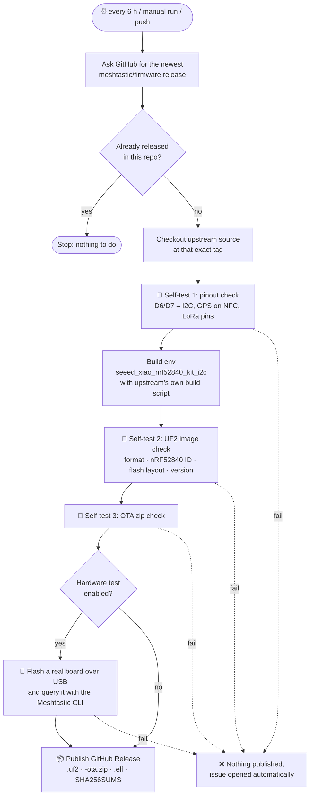

# Meshtastic for XIAO nRF52840 + Wio-SX1262: I2C edition

[](https://github.com/aljaz77/Meshtastic-XIAO-nRF52840-Wio-SX1262-Kit-I2C-firmware-2.8.0.2/actions/workflows/build.yml)
[](https://github.com/aljaz77/Meshtastic-XIAO-nRF52840-Wio-SX1262-Kit-I2C-firmware-2.8.0.2/releases)

Ready-to-flash [Meshtastic](https://meshtastic.org) firmware for the
**Seeed Studio XIAO nRF52840 + Wio-SX1262 kit** (SKU 102010710, or the
standalone Wio-SX1262 for XIAO, SKU 113010003). This build **uses pins D6/D7 as
an I2C bus** (for sensors, OLED screens and so on) instead of the GPS serial
port.

A GitHub Action **checks for new Meshtastic releases every 6 hours**. For each
new release it rebuilds this firmware, self-tests it and publishes it on the
[Releases page](../../releases).

---

## Contents

- [Why this firmware?](#why-this-firmware)
- [Pinout](#pinout)
- [Wiring an I2C device](#wiring-an-i2c-device)
- [Flashing](#flashing)
- [How the automatic build works](#how-the-automatic-build-works)
- [Self-tests](#self-tests)
- [Running and configuring the workflow](#running-and-configuring-the-workflow)
- [Optional: test on real hardware](#optional-test-on-real-hardware)
- [Building it yourself](#building-it-yourself)
- [Credits and license](#credits-and-license)

---

## Why this firmware?

The standard Meshtastic firmware for the XIAO nRF52840 kit
(`seeed_xiao_nrf52840_kit`) reserves the only easy-to-reach spare pins, **D6 and
D7**, for the GPS module's UART. I2C goes to the tiny NFC pads on the back of
the board, where it is hard to solder.

Meshtastic also has an **I2C variant** (`seeed_xiao_nrf52840_kit_i2c`) that
swaps them:

|                  | Standard firmware   | **This firmware (I2C)**  |
| ---------------- | ------------------- | ------------------------ |
| D6 / D7          | GPS UART            | **I2C SDA / SCL**        |
| NFC1 / NFC2 pads | I2C SDA / SCL       | GPS UART                 |
| D0               | GPS standby         | **User button**          |

Official Meshtastic releases don't ship a ready-made binary for this variant
(upstream marks it `board_level = extra`), so this repo builds it for you. The
firmware is **unmodified upstream source**; only the build configuration
differs.

> [!IMPORTANT]
> If you use the **Seeed L76K GNSS module** that plugs onto the kit, it expects
> GPS on D6/D7 and will **not** work with this firmware unless you re-wire it
> to the NFC pads. Use this firmware when you want I2C more than the plug-in
> GPS.

---

## Pinout

| Function            | XIAO pin      | nRF52840 GPIO | Notes                               |
| ------------------- | ------------- | ------------- | ----------------------------------- |
| **I2C SDA**         | **D6**        | P1.11         | your sensors / display              |
| **I2C SCL**         | **D7**        | P1.12         |                                     |
| GPS TX (MCU → GPS)  | NFC1 pad      | P0.09         | pads on the underside of the XIAO   |
| GPS RX (GPS → MCU)  | NFC2 pad      | P0.10         |                                     |
| User button         | D0            | P0.02         | to GND, conflicts with L76K standby |
| LoRa NSS / CS       | D4            | P0.04         | used by the Wio-SX1262              |
| LoRa DIO1           | D1            | P0.03         | used by the Wio-SX1262              |
| LoRa BUSY           | D3            | P0.29         | used by the Wio-SX1262              |
| LoRa RESET          | D2            | P0.28         | used by the Wio-SX1262              |
| LoRa RXEN           | D5            | P0.05         | used by the Wio-SX1262              |
| SPI SCK / MISO / MOSI | D8 / D9 / D10 | P1.13 / P1.14 / P1.15 | used by the Wio-SX1262 |

These values come straight from upstream
[`variant.h`](https://github.com/meshtastic/firmware/blob/master/variants/nrf52840/seeed_xiao_nrf52840_kit/variant.h).
Every automated build re-checks them (see [Self-tests](#self-tests)), so if
Meshtastic ever moves a pin, the build fails instead of publishing firmware
that doesn't match your wiring.

---

## Wiring an I2C device

```
 I2C device             XIAO nRF52840
 ----------             -------------
   VCC  ──────────────  3V3
   GND  ──────────────  GND
   SDA  ──────────────  D6
   SCL  ──────────────  D7
```

- Most breakout boards (BME280, BME680, SHT31, INA219, SSD1306 OLED and so on)
  already have pull-up resistors. With a bare chip, add **4.7 kΩ pull-ups** from
  SDA and SCL to 3V3.
- Power I2C devices from **3V3**, not 5V.
- Meshtastic detects supported sensors and screens on boot. The serial log
  shows `I2C devices found` with their addresses. Enable *Environment
  metrics* in the Telemetry module settings to see sensor readings.

---

## Flashing

### Option A: drag and drop (UF2)

1. Download `firmware-seeed_xiao_nrf52840_kit_i2c-<version>.uf2` from the
   [latest release](../../releases).
2. Plug the XIAO into USB and **double-tap the reset button**. A USB drive
   appears.
3. Copy the `.uf2` file onto that drive. The board reboots into Meshtastic on
   its own. The drive disappearing, sometimes with an "eject" warning, is normal.

> [!TIP]
> **Moving from another firmware, or the device acting oddly?** Copy
> `Meshtastic_nRF52_factory_erase_v3_S140_7.3.0.uf2` (also on the Releases page)
> first. It wipes all stored settings. Then double-tap reset again and copy
> the firmware `.uf2`.

### Option B: over Bluetooth (OTA)

Use `firmware-…-ota.zip` with Nordic's **nRF Device Firmware Update** app
(Android or iOS). See Meshtastic's
[nRF52 OTA guide](https://meshtastic.org/docs/getting-started/flashing-firmware/nrf52/ota/).

> The file `firmware-seeed_xiao_nrf52840_kit_i2c-2.8.0.2a20ee5.uf2` in this
> repository is the original hand-built 2.8.0.2 image. Newer versions are on
> the [Releases page](../../releases).

---

## How the automatic build works

The workflow lives in [`.github/workflows/build.yml`](.github/workflows/build.yml).



Key points:

- **Upstream is the source of truth.** The workflow doesn't keep a patched
  copy of Meshtastic. It checks out the exact upstream release tag and builds
  it with Meshtastic's own `bin/build-nrf52.sh`, using the PlatformIO version
  upstream pins, so it uses the same source and toolchain as the official
  releases.
- **Same version names as upstream.** Upstream release `v2.8.1.8e6a88d`
  becomes release `v2.8.1.8e6a88d` here. Upstream alpha (pre-release) builds
  are published as pre-releases here too.
- **Nothing broken gets published.** Any failing self-test stops the run
  before the release step. If a *scheduled* run fails, the workflow opens a
  GitHub issue ("Automatic build failed for upstream …") so you get notified.
- **Cheap when idle.** A check with no new upstream release takes a few
  seconds and builds nothing.

---

## Self-tests

GitHub's cloud runners have no XIAO attached, so the default tests check
everything that can be checked without hardware.

| # | Test | Script | What it catches |
| - | ---- | ------ | --------------- |
| 1 | **Pinout check** | [`scripts/check_pinout.py`](scripts/check_pinout.py) | Resolves the real PlatformIO build flags for the env, compiles upstream `variant.h` with them, and asserts SDA = D6, SCL = D7, GPS on NFC1/NFC2, button on D0, and all LoRa/SPI pins. Also fails if upstream renames or removes the I2C env. |
| 2 | **UF2 image check** | [`scripts/verify_uf2.py`](scripts/verify_uf2.py) | Valid UF2 container; every block targets the nRF52840 family (`0xADA52840`); the image fits **inside the app region from upstream's linker script**, so it can't overwrite the SoftDevice, your saved config or the bootloader; the version string matches the tag; the SX1262 radio driver and the I2C scanner are linked in. Reports flash usage. |
| 3 | **OTA package check** | inline in workflow | The `-ota.zip` is a valid archive with a DFU `manifest.json`. |
| 4 | *(optional)* **Hardware-in-the-loop** | inline in workflow | Flashes a real board over USB and checks it boots and reports the right version and hardware model. See below. |

You can run tests 1 and 2 on your own computer:

```bash
python3 scripts/verify_uf2.py firmware-seeed_xiao_nrf52840_kit_i2c-2.8.0.2a20ee5.uf2 --version 2.8.0.2a20ee5
```

```bash
cd path/to/meshtastic-firmware && python3 path/to/this-repo/scripts/check_pinout.py
```

---

## Running and configuring the workflow

**Run it now:** go to **Actions → Build & self-test firmware → Run workflow**.
The optional inputs are:

| Input | Default | Meaning |
| ----- | ------- | ------- |
| `upstream_ref` | *(empty)* | Build a specific upstream tag, branch or commit, e.g. `v2.8.0.47db0e3` or `develop`. Branches and commits are built and tested, and the files are attached to the run as an artifact, but they aren't published as a release. |
| `include_prereleases` | `true` | When picking "newest", also consider upstream alpha releases. |
| `force` | `false` | Rebuild and replace the files of a release that already exists here. |

**Repository variables** (*Settings → Secrets and variables → Actions →
Variables*), all optional:

| Variable | Default | Meaning |
| -------- | ------- | ------- |
| `INCLUDE_PRERELEASES` | `true` | Set to `false` to follow only stable (beta) releases on the schedule. |
| `HIL_ENABLED` | *(unset)* | Set to `true` to enable the hardware test job. |
| `HIL_PORT` | `/dev/ttyACM0` | Serial port of the test board on the self-hosted runner. |

**Good to know:**

- Scheduled workflows only run from the **default branch** (`main`).
- In public repositories, GitHub **pauses scheduled workflows after 60 days
  without repository activity**. If that happens, you'll get an email. Click *Enable workflow* on
  the Actions tab, or just push any commit.
- No secrets are needed. The built-in `GITHUB_TOKEN` creates the releases.

---

## Optional: test on real hardware

To make every release prove itself on an actual board:

1. Connect a XIAO nRF52840 + Wio-SX1262 kit **(with antenna attached!)** by
   USB to an always-on Linux machine, such as a Raspberry Pi.
2. On that machine, register a
   [self-hosted GitHub Actions runner](https://docs.github.com/actions/hosting-your-own-runners/managing-self-hosted-runners/adding-self-hosted-runners)
   for this repository and give it the extra label **`xiao-i2c`**. Make sure
   the runner user can access the serial port, for example with
   `sudo usermod -aG dialout <runner-user>`.
3. Set the repository variable `HIL_ENABLED` = `true`, and `HIL_PORT` if the
   board isn't `/dev/ttyACM0`.

The `hardware-test` job then flashes each new build with `adafruit-nrfutil`
(serial DFU), waits for it to boot, and runs `meshtastic --info`. The test
passes if the node reports the expected firmware version and the
`XIAO_NRF52_KIT` hardware model. A release is only published if this passes.

> [!NOTE]
> The test board gets re-flashed automatically, so don't use your everyday
> node for it. This job hasn't been run against real hardware yet, so the
> first run may need small adjustments, such as the boot wait time.

---

## Building it yourself

You need Python 3 and git:

```bash
git clone --recurse-submodules --branch v2.8.1.8e6a88d https://github.com/meshtastic/firmware.git
```

```bash
cd firmware && pip install -r .github/actions/setup-base/requirements.txt
```

```bash
bash bin/build-nrf52.sh seeed_xiao_nrf52840_kit_i2c
```

Output goes to `release/`. Replace the tag with any
[upstream release](https://github.com/meshtastic/firmware/releases).

---

## Repository layout

```
.github/workflows/build.yml   automatic check → build → self-test → release pipeline
.github/actionlint.yaml       lint config (declares the self-hosted runner label)
scripts/check_pinout.py       self-test 1: pin assignments vs. upstream variant.h
scripts/verify_uf2.py         self-test 2: UF2 image validation
firmware-…-2.8.0.2a20ee5.uf2  original hand-built 2.8.0.2 image
```

---

## Credits and license

- Firmware: [Meshtastic](https://github.com/meshtastic/firmware), licensed
  **GPL-3.0**. Every release here links to the exact upstream source tag it
  was built from.
- Board support: the `seeed_xiao_nrf52840_kit_i2c` variant is maintained
  upstream by the Meshtastic community and Seeed Studio.
- This repository just automates building, testing and publishing that variant.
  It isn't affiliated with or endorsed by Meshtastic LLC or Seeed Studio.
